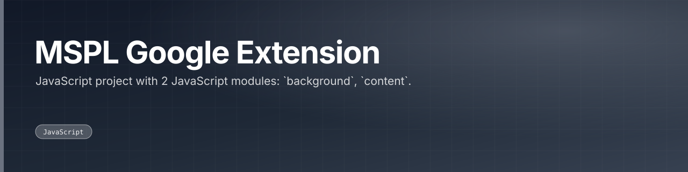

 

 

---

## What this is

JavaScript project with 2 JavaScript modules: `background`, `content`. Also checked in: 1 markdown document. The sections below are read from the repository itself, 5 tracked files as of 2024-01-23.

|  |
|:--:|
| **1** |
| docs |

---

<a href="https://github.com/gowtham-creator/MSPL-Google-Extension">gowtham-creator/MSPL-Google-Extension</a>

